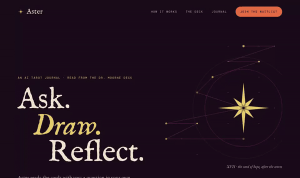
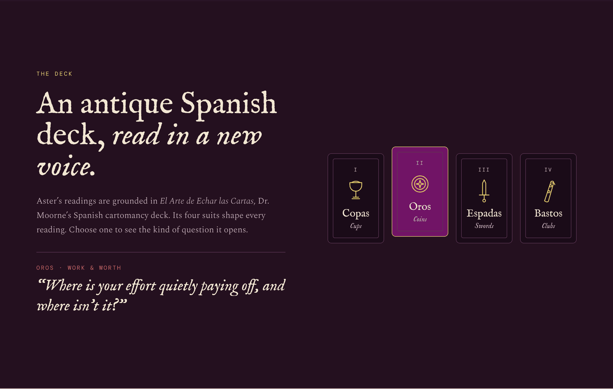
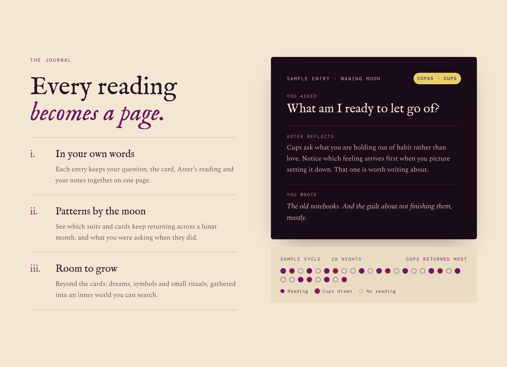

<h1 align="center">✦ Aster</h1>

<p align="center"><strong>Ask. Draw. Reflect.</strong></p>

<p align="center">
  An AI tarot journal. Ask a question in your own words, draw from the Dr. Moorne deck,<br>
  and get a reading written back to you. Then Aster keeps the page.
</p>

<p align="center">
  
  
  
  
  
</p>

<p align="center">
  
</p>

---

## 🌙 What is Aster?

Aster reads the cards with you. You bring a real question, draw from *El Arte de Echar las Cartas*, Dr. Moorne's Spanish cartomancy deck, and Aster writes a reflection back. Every reading becomes a journal page, so over time you can see which suits and themes keep returning.

The name is deliberately indirect (stars, flowers, celestial imagery) so Aster can grow into broader symbolic journaling.

🌐 **Live site:** linked in this repo's About section.

## 🚧 Status

Built in public. The landing page and waitlist come first, to test whether there's enough interest to build the app.

| Milestone | Target | |
|---|---|---|
| Landing page and waitlist | December 2026 | 🚀 In progress |
| Working reading (web prototype) | March 2027 | ⏳ |
| iPhone beta, including iPhone Duo layouts | May 2027 | ⏳ |
| Public launch | Summer 2027 | ⏳ |

## ✨ What's on the landing page

- **Parallax star map:** the hero is five layers at different depths. They move at different speeds as you scroll and drift toward the mouse on desktop. Scroll and pointer positions go to CSS variables once per frame, so React never re-renders while you scroll.
- **Suit picker:** choose one of the deck's four suits (Copas, Oros, Espadas, Bastos) to see the kind of question it opens.
- **Waitlist with source tracking:** sign-ups post to a Google Form. Each one records which form was used and where the visitor came from (`utm_source` or referrer), so I can see which channels bring people in.
- **Accessible by default:** real buttons and labels, keyboard focus styles, live regions for changing text, and everything holds still when Reduce Motion is on.

## 📸 Screenshots

<table>
  <tr>
    <td></td>
    <td width="68%"></td>
  </tr>
</table>



## 🧱 How it's built

A [Turborepo](https://turborepo.com) monorepo, so the website and the future iPhone app can share code.

```
apps/
  web/          Next.js landing page and waitlist, hosted on Vercel
packages/
  deck/         Deck data (suits, themes, prompts) shared by every app
docs/           Images for this README
```

- **Web:** Next.js (App Router), React 19, TypeScript, Tailwind CSS 4
- **Waitlist:** a Google Form for now; a database arrives with the app
- **Analytics:** Vercel Web Analytics (cookie-free page views)
- **Planned:** Claude API readings with structured output, and an Expo (React Native) iPhone app in `apps/mobile`

## 🛠️ Run it locally

Needs Node 24 (see `.nvmrc`).

```bash
nvm use
npm install
npm run dev
```

Then open [localhost:3000](http://localhost:3000).

To test the waitlist, copy `apps/web/.env.example` to `apps/web/.env.local` and fill in the Google Form values.

| Command | What it does |
|---|---|
| `npm run dev` | Starts the site and reloads on save |
| `npm run build` | Production build, same as Vercel runs |
| `npm run typecheck` | Type-checks every package |

## 🎴 Notes

All artwork in this repo is original. Card meanings follow the Dr. Moorne deck.

---

<p align="center">Built by <a href="https://jotrio.com">Jhon Trujillo</a> ✦</p>